# BUSY Bar apps

Sixteen JavaScript apps for the [BUSY Bar](https://busy.app), a desk display of 72 x 16 pixels. All run on the bar itself: no computer, no account, no key. The four with live data fetch it over the bar's Wi-Fi, Vinyl gets the song from your Mac or Spotify and its lyrics from lrclib.net; the others use no internet at all.

| App | What it is |
|---|---|
| **Live on the desk** | |
| **[Vinyl](vinyl/)** | What you are listening to as a record player, with synced lyrics; from a small Mac app or your Spotify account. |
| **[Gameday](gameday/)** | NFL game day as a live score strip, with the field, the timeouts, big-play signs and countdowns to kick-off. |
| **[Hoops](hoops/)** | NBA game night as a live score strip, with who has the ball, the timeouts, runs and fouls, big-play signs and countdowns to tip-off. |
| **[Stocks](stocks/)** | Stock, index, crypto and currency prices, one ticker at a time, with the day's line and the extended sessions. |
| **Focus and calm** | |
| **[Flight](flight/)** | A focus timer dressed as a flight: check in at one of 3,244 real airports, get a boarding pass, and watch the real sky go by until you land. |
| **[Breathe](breathe/)** | A light to breathe with. Follow it in and out for one to five minutes, in three patterns, each with its own colour. |
| **[Pick For Me](pick_for_me/)** | A reel that decides for you what to eat, drink, wear or watch, where to go, yes or no, or picks from your own list. |
| **Things to watch** | |
| **[Baggage Claim](baggage_claim/)** | An airport baggage belt seen from above: endless luggage, and now and then something that is not. |
| **[Fish Tank](fish_tank/)** | A tank of pet fish. Feed them, but not too often, and open three capsules a day in the fish shop. |
| **[Plate by Plate](plate_by_plate/)** | A conveyor-belt sushi bar to watch and eat from. Take a plate, eat it in three bites, return the plates for keepsakes. |
| **[Slosh](slosh/)** | A glass tank of simulated water. Push it, tilt it, watch the waves, and float a rubber duck on it. |
| **Games** | |
| **[Bop Back](bop_back/)** | Watch a little act play a rhythm, then play it back with Start. Five acts, eight levels, three hearts. |
| **[Chop Chop](chop_chop/)** | Cut bread, fish and more into even pieces before the time runs out. |
| **[Ember](ember/)** | A slingshot game. Sling a glowing ember at towers of ice and stone and knock out every gem with five embers. |
| **[Lucky Reels](lucky_reels/)** | A three-reel slot machine with play coins only. No real money anywhere. |
| **[Same Page](same_page/)** | A party game for a group. The clue-giver peeks at a hidden spot on a scale and gives a clue, the others guess. |

Each app's folder has its own README with what it shows, the controls, the settings, and what it keeps on the bar.

## Vinyl

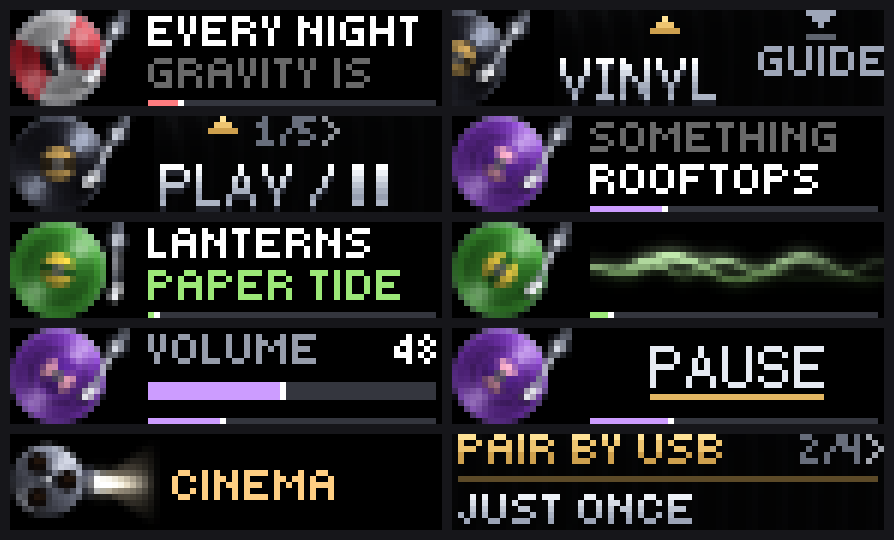

The song playing on your Mac (Spotify, Apple Music, QQ Music, NetEase, a browser...) or on your Spotify account, as a record on a turntable: one record per album, the arm lifts at a pause, the records change at a song's end, and the lyrics run beside it in two rows. Start plays and pauses, the knob sets the volume, OK changes the view (lyrics, song info, waves). Needs the small helper Vinyl for Mac (one line in Terminal; the bar pairs with it once over USB and then talks over Wi-Fi) or your own Spotify keys; [setting it up](vinyl/SETUP.md). [More about Vinyl](vinyl/)

## Gameday


One NFL game at a time as a strip: both teams, the score, the quarter and a clock that ticks between looks, the ball on the field along the bottom, timeouts, down and distance, and signs for touchdowns, field goals, turnovers and sacks with the player's number and name. The game on show is looked at every 5 seconds. [More about Gameday](gameday/)

## Hoops


One NBA game at a time as a strip: the score, a clock that ticks between looks, and along the bottom the quarter's time as a line in the colour of the team with the ball, with a light running the way it attacks. Timeouts, runs, team fouls while the clock is stopped, and signs for threes, runs, lead changes and the final. The game on show is looked at every 5 seconds. [More about Hoops](hoops/)

## Stocks

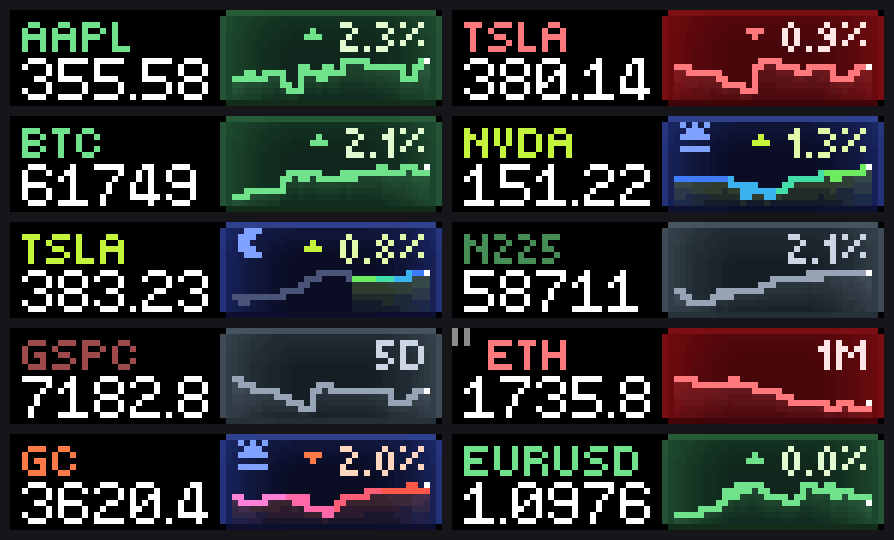

One ticker at a time: the price, the day's change and its line, in green or red, and in night blue with a sun or a moon while a stock trades before the opening or after the close. Start switches between today, 5 days and 1 month. [More about Stocks](stocks/)

## Flight


Choose where you are, how long you want to focus and an airport that far away; press the knob to find an airport by its three letters. The boarding pass is printed, the aircraft takes off, and the window shows the sky where you are flying: the sun and the moon where they stand, the moon's phase, stars, and clouds from the real weather. Landing ends the session. [More about Flight](flight/)

## Breathe

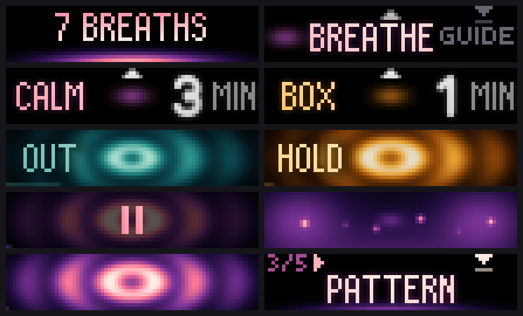

A soft light swells and sinks; you breathe with it. Three patterns (calm, box, sleep), each in its own colour, for one to five minutes, with a quiet close at the end. Not medical advice, just a rhythm to follow. [More about Breathe](breathe/)

## Pick For Me

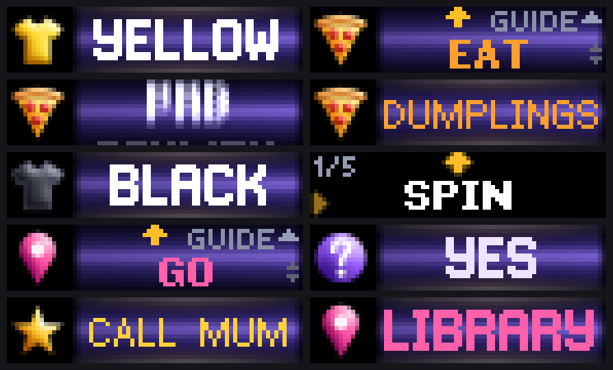

Turn to a list (eat, drink, wear, watch, go, yes or no, or your own), press Start, and the reel spins down to one answer. [More about Pick For Me](pick_for_me/)

## Baggage Claim

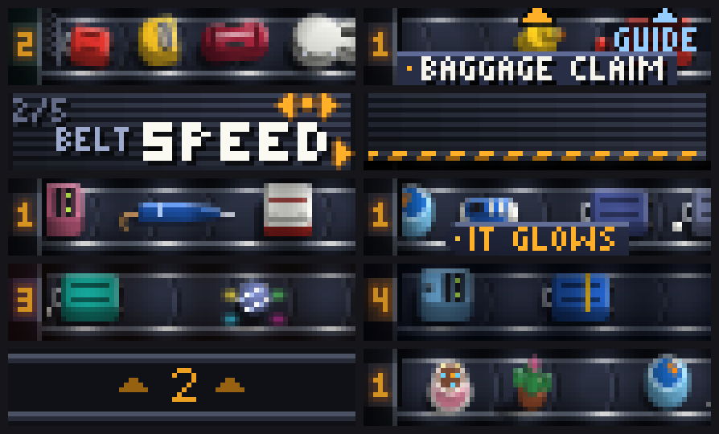

Suitcases, boxes and bags ride four belts past the lamps, seen from above. Now and then something comes round that is not luggage. Start asks what the thing in the light is. [More about Baggage Claim](baggage_claim/)

## Fish Tank

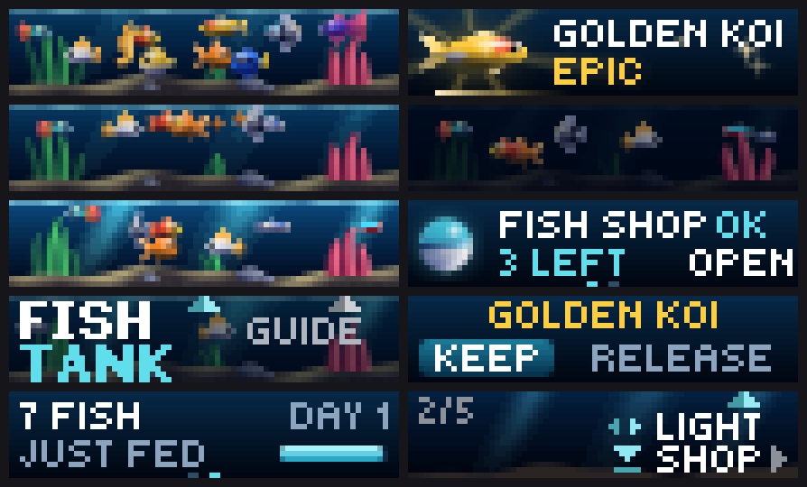

Twelve kinds of fish, hungry in real time. Feed them (not too often), light the tank with the knob, and open up to three capsules a day in the fish shop to see who moves in. [More about Fish Tank](fish_tank/)

## Plate by Plate

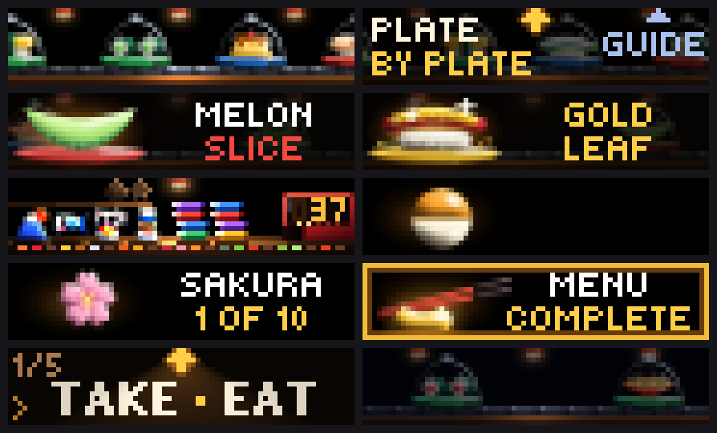

Plates glide past under glass domes. Take the one in the light, eat it in three bites, pile the empty plates on your table and drop them into the slot; every fifth plate plays a capsule for a keepsake. [More about Plate by Plate](plate_by_plate/)

## Slosh

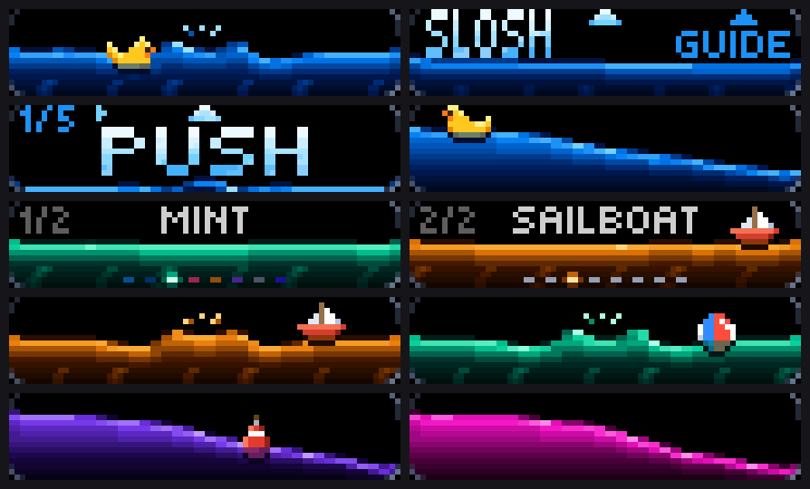

The water is simulated, not played back: push it and a crown jumps up, tilt it and a wave climbs the glass and breaks. Eight waters, seven things that float. [More about Slosh](slosh/)

## Bop Back

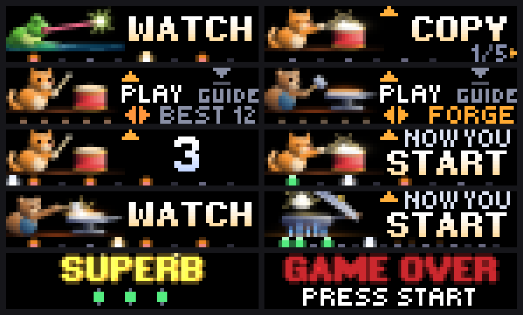

A cat at a drum, a bear at an anvil, a frog and a firefly, a woodpecker, a popcorn pan. Watch the phrase, count three, play it back on Start; the verdict shows every hit early or late. [More about Bop Back](bop_back/)

## Chop Chop

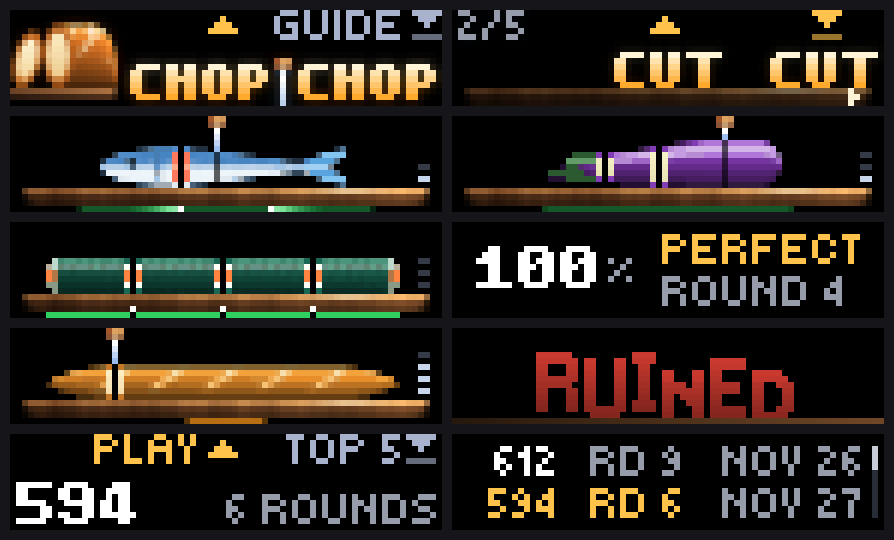

Ten foods, one to six cuts a round against a time line. The score is how even the pieces are, from PERFECT to RUINED. [More about Chop Chop](chop_chop/)

## Ember

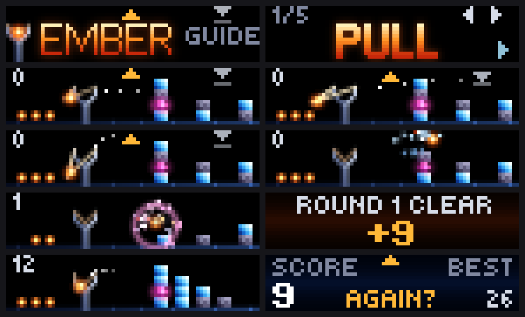

More than 6,000 fields that get harder slowly. Ice shatters, stone cracks first, and what loses its footing falls on what is underneath. [More about Ember](ember/)

## Lucky Reels

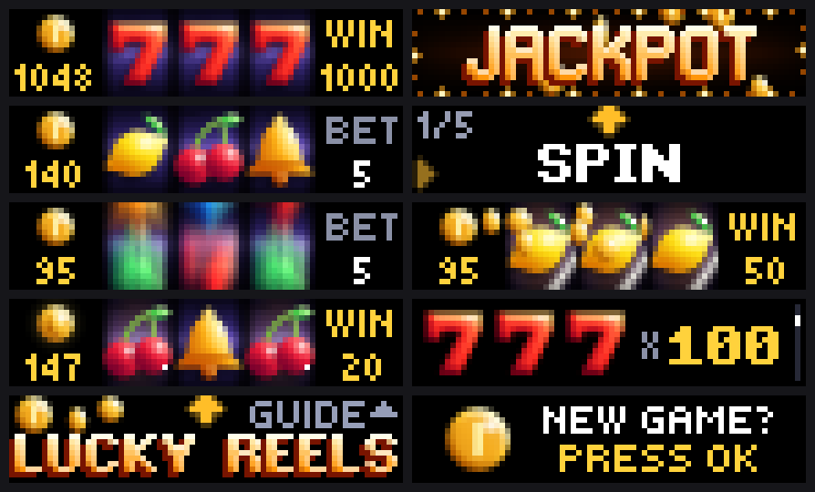

Three reels, a bet you set with the knob, a pay table, and a jackpot sign worth waiting for. Play coins only; nothing can be bought. [More about Lucky Reels](lucky_reels/)

## Same Page

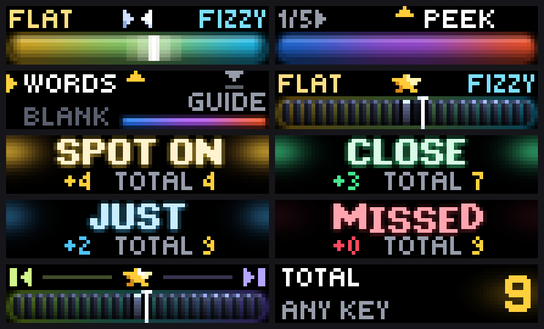

A band of light hides a target behind a shutter. One player peeks and gives a clue between two opposites, the others turn the knob to guess, and the reveal scores 4, 3, 2 or 0. The back screen prompts the table and never shows the target. [More about Same Page](same_page/)

## Controls at a glance

The bar has a knob that turns and can be pressed (OK), a top button (Start) and Back.

The twelve newer apps open on a main screen: Start enters, pressing the knob opens a short guide of five pages you turn yourself, Back leaves. The first time, the guide opens by itself. Vinyl and the four things to watch also enter by themselves after a few seconds. On every page the same marks are used: a triangle pointing up for Start, a triangle pointing down onto a line for a press of the knob, two side arrows for a turn. What the controls do inside each app is in its README.

The four older apps start straight away:

| | Turn | OK | Start | Back |
|---|---|---|---|---|
| **Flight** | choose; in the air, the other page | in the hall, check in; on an airport page, find one by its letters; in the air, keep the page | logbook; next step, ticket and boarding; in the air, pause | a step back; in the air, end early |
| **Gameday** | another game | team marks or letters | a look round the league; a turn of the knob comes back | exit |
| **Hoops** | another game | jerseys or letters | a look round the league; a turn of the knob comes back | exit |
| **Stocks** | another ticker | stay on this ticker | today, 5 days, 1 month | exit |

## Building

Each app is a project of its own, laid out like the official template (`npm create @busy-app/app`) and built with [busy-cli](https://www.npmjs.com/package/@busy-app/cli). Node 24 is needed.

```sh
cd flight             # or any other app's folder
npm ci
npm run build         # -> dist/<app id>.tgz
npm run app:install   # onto a BUSY Bar connected over USB
npm run app:run
```

## Layout of an app

```
src/main.js        the entry point (in most apps one generated file, with its data at the top)
src/*.js           the modules it imports
src/appmeta/       manifest.json, settings.json, the two menu icons
src/images/        pictures the app draws with (Gameday, Hoops)
src/animations/    films the bar plays by itself: title cards, signs, page changes, guide pages, the author's mark at the start
screenshots/       72 x 16, captured from the BUSY Bar Emulator
preview.png        the ten screenshots together, six times as large
CATALOG.md         the text the BUSY Bar catalog shows for the app
flight/airports/   the airport tables Flight fetches once after it is installed
vinyl/helper/      Vinyl for Mac, the small program that tells the bar what is playing (SETUP.md has the steps)
```

The apps are plain JavaScript and use no library: they talk to the bar's HTTP API with `fetch`.

## How these were made

The ideas, what each app shows, how it behaves and how it looks are the author's, decided screen by screen on a BUSY Bar and in the official emulator. The code and the pixel drawings were written with an AI coding assistant (Claude Code) under that direction and tested on the device.

## Notes

- The data sources are unofficial public endpoints (ESPN for Gameday and Hoops; Yahoo Finance for Stocks, with CNBC and then Tencent filling in where Yahoo cannot be reached; Open-Meteo for Flight's clouds; lrclib.net for Vinyl's lyrics). They need no key and can change without notice. Vinyl's Spotify mode uses Spotify's own Web API with keys you make yourself.
- Flight's airport tables are built from OurAirports (public domain) and OpenFlights (Open Database License); see [flight/airports](flight/airports/). The bar fetches them from this repository on GitHub, or through the jsDelivr CDN where GitHub does not answer.
- Gameday shows each team as a small pixel drawing of its mark, made for this app (the branch `no-logos` has the app with a plain helmet in the team's colours instead); a team it does not know gets a grey helmet. Hoops draws a plain jersey in the team's colours over its three letters.
- The eleven games, tools and things to watch use no internet connection; what they keep (a best score, a tank of fish, a list) stays in the app's storage on the bar.
- All drawings, words and sounds in the games and the things to watch were made for these apps. They are not based on, or affiliated with, any other game, toy, restaurant or brand.
- Not affiliated with or endorsed by the NFL, the NBA, ESPN, Yahoo, CNBC, Tencent, Spotify, Apple, LRCLIB, any airline or airport, or Flipper.

## License

[MIT](LICENSE). The airport tables in `flight/airports` are under the Open Database License.
