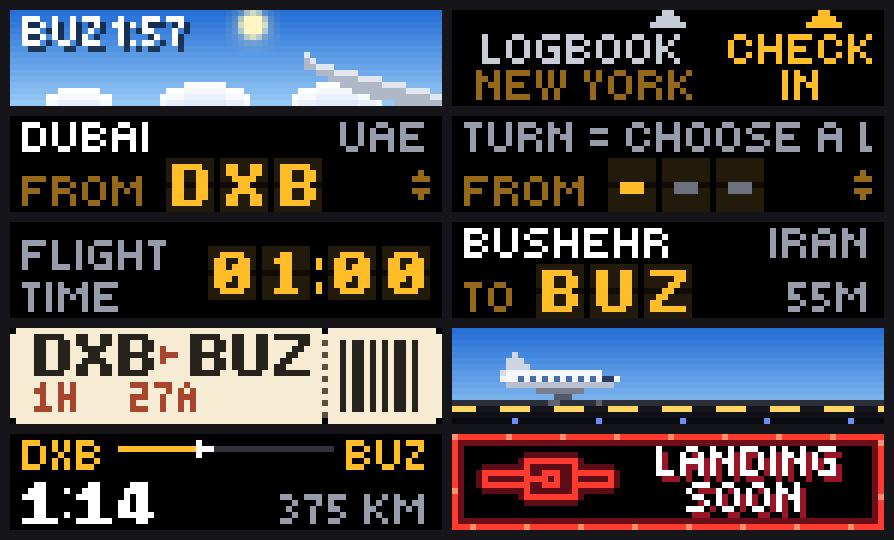
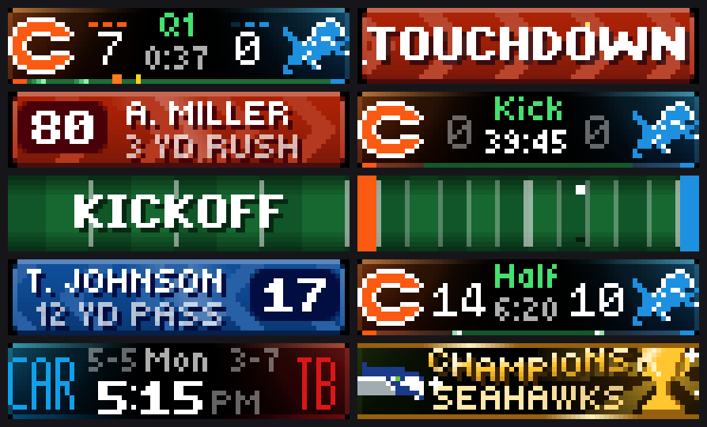
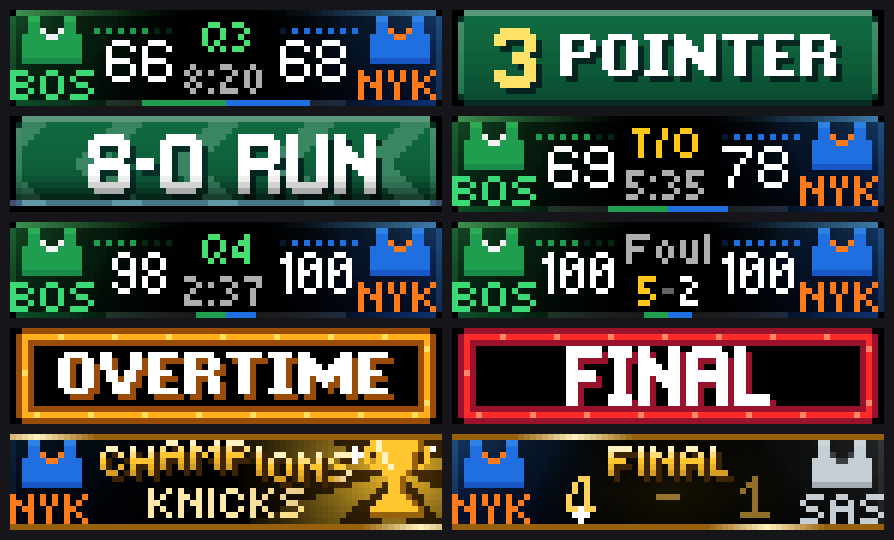

# BUSY Bar apps

Four JavaScript apps for the [BUSY Bar](https://busy.app), a desk display of 72 x 16 pixels. All run on the bar itself and fetch what they need over its Wi-Fi: no computer, no account, no key.

| App | What it is |
|---|---|
| **[Flight](flight/)** | A focus timer dressed as a flight: check in at one of 3,244 real airports, get a boarding pass, and watch the real sky go by until you land. |
| **[Gameday](gameday/)** | NFL game day as a live score strip, with the field, the timeouts, big-play signs and countdowns to kick-off. |
| **[Hoops](hoops/)** | NBA game night as a live score strip, with the timeouts, runs and fouls, big-play signs and countdowns to tip-off. |
| **[Stocks](stocks/)** | Stock, index, crypto and currency prices, one ticker at a time, with the day's line and the extended sessions. |

Each app's folder has its own README with what it shows, the controls, the settings, and where its data comes from.

## Flight



Choose where you are, how long you want to focus and an airport that far away. The boarding pass is printed, the aircraft takes off, and the window shows the sky where you are flying: the sun and the moon where they stand, the moon's phase, stars, and clouds from the real weather. Landing ends the session. [More about Flight](flight/)

## Gameday



One NFL game at a time as a strip: both teams, the score, the quarter and the clock, the ball on the field along the bottom, timeouts, down and distance, and signs for touchdowns, field goals, turnovers and sacks with the player's number and name. [More about Gameday](gameday/)

## Hoops



One NBA game at a time as a strip: the score, the quarter's time as a line along the bottom, timeouts, runs and team fouls, and signs for threes, runs, lead changes and the final. [More about Hoops](hoops/)

## Stocks


One ticker at a time: the price, the day's change and its line, in green or red, and in night blue with a sun or a moon while a stock trades before the opening or after the close. [More about Stocks](stocks/)

## Controls at a glance

The bar has a wheel that can be pressed (OK), a top button (Start) and Back.

| | Wheel | OK | Start | Back |
|---|---|---|---|---|
| **Flight** | choose; in the air, the other page | next step; in the air, keep the page | logbook, airport search, ticket and boarding; in the air, pause | a step back; in the air, end early |
| **Gameday** | another game | team marks or letters | a look round the league | exit |
| **Hoops** | another game | jerseys or letters | a look round the league | exit |
| **Stocks** | another ticker | stay on this ticker | today, 5 days, 1 month | exit |

## Building

Each app is a project of its own, laid out like the official template (`npm create @busy-app/app`) and built with [busy-cli](https://www.npmjs.com/package/@busy-app/cli). Node 24 is needed.

```sh
cd flight             # or: cd gameday, cd hoops, cd stocks
npm ci
npm run build         # -> dist/<app id>.tgz
npm run app:install   # onto a BUSY Bar connected over USB
npm run app:run
```

## Layout of an app

```
src/main.js        the entry point (Flight and Hoops are one generated file, with their data at the top)
src/*.js           the modules it imports
src/appmeta/       manifest.json, settings.json, the two menu icons
src/images/        pictures the app draws with (Gameday, Hoops)
src/animations/    films the bar plays by itself: title cards, signs, page changes, take-off and landing
screenshots/       72 x 16, captured from the BUSY Bar Emulator
CATALOG.md         the text the BUSY Bar catalog shows for the app
flight/airports/   the airport tables Flight fetches once after it is installed
```

The apps are plain JavaScript and use no library: they talk to the bar's HTTP API with `fetch`.

## How these were made

The ideas, what each app shows, how it behaves and how it looks are the author's, decided screen by screen on a BUSY Bar and in the official emulator. The code and the pixel drawings were written with an AI coding assistant (Claude Code) under that direction and tested on the device.

## Notes

- The data sources are unofficial public endpoints (ESPN for Gameday and Hoops; Yahoo Finance and CNBC for Stocks; Open-Meteo for Flight's clouds). They need no key and can change without notice.
- Flight's airport tables are built from OurAirports (public domain) and OpenFlights (Open Database License); see [flight/airports](flight/airports/).
- Gameday shows each team as a small pixel drawing of its mark, made for this app (the branch `no-logos` has the app with a plain helmet in the team's colours instead). Hoops draws a plain jersey in the team's colours over its three letters.
- Not affiliated with or endorsed by the NFL, the NBA, ESPN, Yahoo, CNBC, any airline or airport, or Flipper.

## License

[MIT](LICENSE). The airport tables in `flight/airports` are under the Open Database License.
