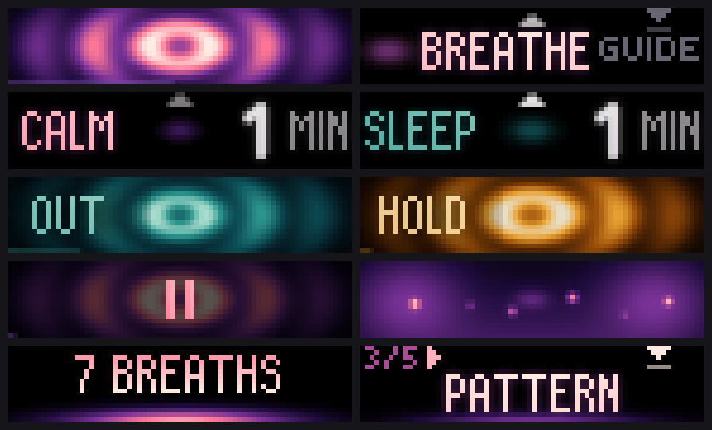

# Breathe

A light to breathe with. It swells as you breathe in and sinks as you breathe out. Follow it for one to five minutes to calm down, to concentrate, or before sleep.

*The pictures are the app's own screens, captured from the BUSY Bar Emulator.*

## What you see

- The main screen, at every start: the name, the light at rest, a small arrowhead under Start (the button on top) that moves up to it and back, and at the knob the mark for a press with the word GUIDE.
- The choice: the light at rest in the middle, the name of the pattern on its left, the minutes on its right.
- Three patterns, each with its own colour of light. Calm (purple) is a guided breath of seven breaths a minute, out longer than in, with no holds. Box (gold) is in for 4 seconds, hold 4, out 4, hold 4. Sleep (teal) is in for 4, hold 7, out 8.
- A session: only the light. It grows quickly at first and settles, and lets go slowly. With the first three breaths the words IN, HOLD and OUT appear for a moment, then there is nothing but the light. A thin line along the bottom edge shows how far the session is.
- A session is made of whole breaths and always ends on a breath out. One minute of Calm is seven breaths.
- The end: the light lets go of one wide wave that runs to both ends of the bar, a few motes rise, and the light settles into an afterglow. Then a short summary, a line at a time: the minutes, the breaths and, from the second day in a row, the day count.
- The first time you open the app, a short guide of five pages shows what each control does. Pressing the knob (OK) on the main screen opens it again.

## Controls

- Main screen: the app opens here and waits. Start goes on to the choice. Pressing the knob (OK) opens the guide. Back leaves the app.
- The choice: turn the knob for 1 to 5 minutes. OK goes to the next pattern. Start begins the session. Back returns to the main screen.
- In a session: Start pauses and goes on. When paused, the light dims and two bars stand under Start. Back stops the session and returns to the choice.
- Summary: any control returns to the choice. It also returns by itself after a while.
- Guide: Start, OK or a turn of the knob forward goes to the next page. A turn back or Back goes to the page before. Any control on the last page, or Back on the first, closes the guide and returns to the main screen.

## Settings

- Words: IN, HOLD and OUT with the first three breaths of a session. On by default.
- Start with: the pattern the app opens with. Calm, Box or Sleep.
- Start over: flip this switch to clear everything this app has kept and see the guide again. Each flip starts over once. Cannot be undone.

## Data and privacy

- Kept on the bar, in the app's own storage: the number of sessions, the minutes, the last day and the days in a row, the chosen length, and whether the guide has been seen.
- The app uses no internet connection and no account. Nothing leaves the bar.
- This is a breathing exercise for calming down. It is not medical advice and not a medical device. If breathing this way makes you dizzy or unwell, stop.
- This app is not affiliated with any other breathing or mindfulness product.

## Building

- The app is one script, src/main.js, and the films in src/animations. Build the package with npm ci and then npm run build (busy-cli); the result is dist/io.github.windagh.breathe.tgz.
