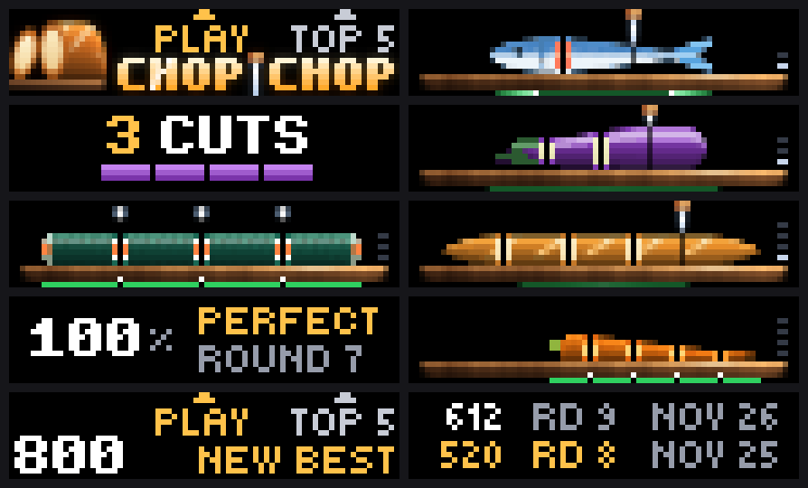

# Chop Chop

A small game of skill: cut the food into pieces of the same length before the time runs out. Turn the wheel to place the knife and press to cut; the more even the pieces, the higher the score, and one bad cut ends the game.

*The pictures are the app's own screens, captured from the BUSY Bar Emulator.*

## What you see

- **The title**: a loaf on its board and the name, with PLAY under the top button and TOP 5 under the wheel.
- **Before a game**, a card says what the controls do. It waits until you touch a control.
- **Before each round**, a card says how many cuts: 1 CUT, 3 CUTS, up to 6.
- **A round**: the food lies on the board, the knife hovers over it and its shadow shows where it will cut. The line along the bottom is the time: it shrinks from both ends towards the middle, green, then amber, then red in the last second.
- **Ten foods**: a loaf, a baguette, a cucumber, an aubergine, a fish, a carrot, a sausage, a roll cake, tofu and a sushi roll, each with its own inside where it is cut.
- **The judging**: white marks show where the cuts belonged and a coloured line shows each piece (green is right, orange is one column off, red is more). Then the percentage counts up with a verdict: PERFECT, CLEAN, DECENT or ROUGH.
- **Game over**: when a round falls below the pass mark the word is RUINED; you see your total, the rounds you got through and your best.
- **Top 5**: your five best games with score, round and date; the newest is in amber.

## How it is scored

- All pieces must have the same length, measured between the outer ends of the food, whatever its shape (a fish counts from nose to tail).
- A round scores 100 minus the average error of the pieces in per cent. A perfect cut is always possible.
- The pass mark starts at 60 and rises to 75. Later rounds have more cuts (up to six) and less time, and from round 8 the food may lie off the middle.
- Cuts you did not make when the time is up count against you.

## Controls

- **Title**: the top button plays, a press of the wheel opens the top 5, Back exits.
- **Controls card**: any turn or press starts the game (it is not a cut); Back returns to the title.
- **Round**: the wheel moves the knife, one column a click and faster when you spin it; a press of the wheel or the top button cuts; Back pauses.
- **Pause**: the top button resumes, Back quits to the title.
- **Game over**: the top button plays again, a press of the wheel opens the top 5, Back goes to the title.
- **Top 5**: the wheel scrolls, the top button plays, Back goes back.

## Settings

- **Controls card at start**: on by default. Off: a game from the title starts at once.
- **Start over**: clears the five best games and everything else the app has kept. It acts when you switch it on; switch it off again afterwards. This cannot be undone.

## Data and privacy

- The app keeps one small file on the bar: your five best games and whether the rule card has been shown.
- It uses no internet connection and sends nothing anywhere. Nothing leaves the bar.
- At every start it shows the author's mark for a second and a half.
- All drawings are the author's own. The app is not affiliated with any other game, brand or product of a similar name.
