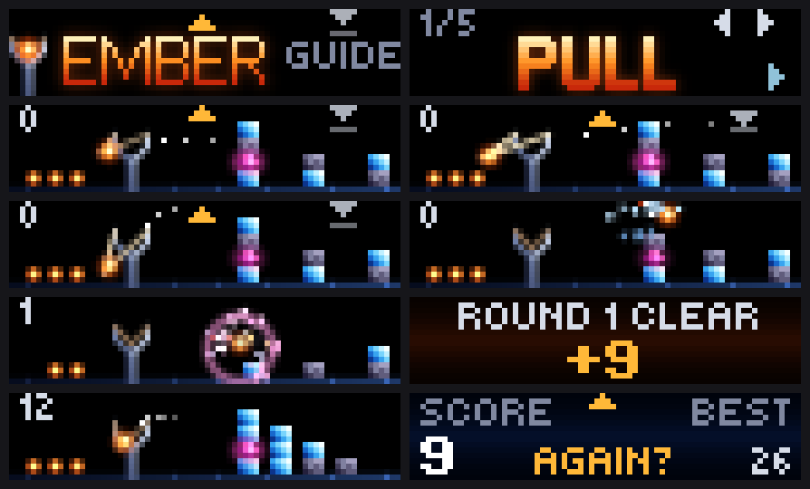

# Ember

A slingshot game for the BUSY Bar. Sling a glowing ember at towers of ice and stone, and knock out every gem in them with five embers.

*The pictures are the app's own screens: the ones of play (6 to 9) captured from the BUSY Bar Emulator, the others rendered from the app's own films and letters.*

## What you see

- The field: a sling with an ember on the left, towers on the right. Ice breaks at any touch. Stone needs a fast hit or a second one; the first leaves it cracked. A gem goes at any touch, and whenever it falls.
- What loses its footing falls straight down. A falling stone crushes ice and gems under it.
- A short dotted arc shows how the shot starts out, not where it lands.
- The embers still to come wait in a row behind the sling and move up as they are used. The score is in the top left corner.
- Every round is a new field: free towers, a low wall, one tall tower, stairs, a stone pillar with a gem behind it, a gem on top of a tower, a stone cap on ice, a gate. There are more than 6,000 different fields. They get harder slowly, with an easier round now and then, and every one of them was checked to be clearable in several different ways.
- A round cleared with the first ember, and a collapse of two or more pieces, earn a little extra.
- When the embers are used up: your score, the best score and the furthest round.

## Controls

- Main screen: the app opens here every time. Start starts a game. Pressing the knob (OK) opens the guide. Back leaves the app.
- Guide: five short pages show the controls. It opens by itself the first time you open the app, and later whenever you press the knob (OK) on the main screen. Start, OK or a turn of the knob forward goes to the next page; a turn backward or Back goes one page back. Any control on the last page, or Back on the first, closes the guide and leads to the main screen.
- Aiming: turn the knob to draw the sling back, further for a harder shot. OK changes between a flat, fast shot and a high lob. Start lets go. Back opens the pause card.
- Pause card: turn the knob to choose RESUME, NEW or EXIT, Start (or OK) takes it, Back resumes.
- Game over: Start (or OK) plays again, Back goes to the main screen.

## Scoring

- 3 points for a gem, 3 for each ember left when the round is cleared, 5 more for clearing it with the first ember, and 1 for each piece in a collapse.

## Settings

- Aiming dots: the dotted arc. Switch it off to aim by feel.
- Start over: flip this switch to clear the best score and the furthest round and to see the guide again. Each flip starts over once.

## Data and privacy

- The app keeps on the bar: your best score, the furthest round you reached, and that you have seen the guide.
- It uses no internet connection and no account. Nothing leaves the bar.
- Ember is an original game. It is not affiliated with, or based on, any other slingshot game or its makers.

## Building

- Node 24 (see .nvmrc), then: npm ci, and COPYFILE_DISABLE=1 npm run build. The package is dist/io.github.windagh.ember.tgz.
- src/main.js is generated from the author's working sources; its head comment says how it is laid out.
