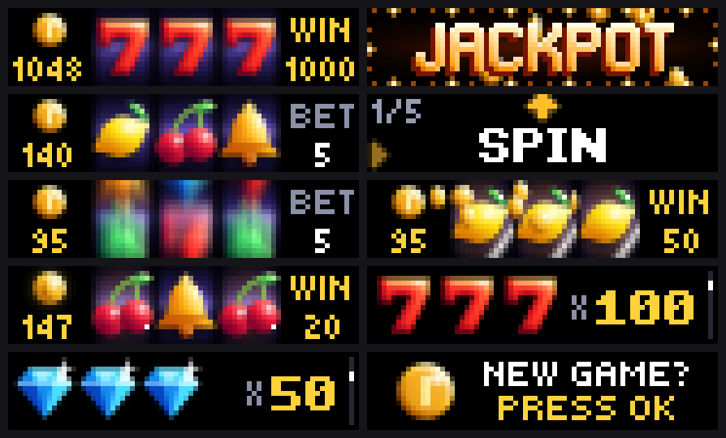

# Lucky Reels

A three-reel slot machine for your desk. The coins are play coins only: nothing can be bought, won or cashed out, and no real money is involved anywhere.

*The pictures are the app's own screens, captured from the BUSY Bar Emulator.*

## What you see

- The machine: three reels with the pay line across the middle, your coins at the left, your bet at the right.
- A spin: the reels blur, then stop one after another from left to right, each with a small clunk.
- A win: the reels that won light up, coins fly into your balance and the number counts up.
- Jackpot: three sevens or three diamonds bring up the JACKPOT sign over the whole screen.
- Out of coins: a short scene with an empty coin bag, then NEW GAME? and you have 100 coins again.

## What pays

- Three of a kind pay this many times the bet: cherry 5, lemon 10, clover 15, bell 25, diamond 50, seven 100.
- Two cherries anywhere on the line pay 2 times the bet.
- A little more than one spin in four wins something. In the long run the machine gives back about 94 of every 100 coins played. The odds are the same for every bet.

## Controls

- At every start a short guide shows the controls: five numbered pages, one control on each, the word in large letters under an arrow that points at its control. The top button, a press of the wheel or a turn forward goes to the next page; a turn back or Back goes to the page before (Back on the first page leaves the app). On the last page any key starts the game, and does nothing else.
- The machine: the top button spins. Turn the wheel to set the bet: 1, 2, 5, 10 or 25 coins, never more than you have. Press the wheel for the info pages. Back leaves the app.
- While a win is still counting: the top button starts the next spin at once.
- Info pages: your coins and your best win, the pay table, the number of spins. Turn the wheel to go through them. Press the wheel, the top button or Back to return to the machine.
- New game page: press the wheel or the top button for a new game with 100 coins. Back leaves the app.

## Settings

- Quick spins: the reels stop sooner. Off at first.
- Guide at start: the guide to the controls at every start. On at first.
- Start over: clears everything the app has kept and starts a new game with 100 coins. Switch it on, then off again. This cannot be undone.

## Data and privacy

- Kept on the bar, in the app's own storage: your coins, your bet, your best win and the number of spins. Nothing else.
- The app does not use the internet. Nothing leaves the bar.
- Play coins only. There are no purchases, no prizes and no way to turn coins into anything. It is a game for fun, not gambling for money.
- Every spin is decided by chance on the bar.
- This app is not affiliated with any casino, game maker or slot machine brand.
