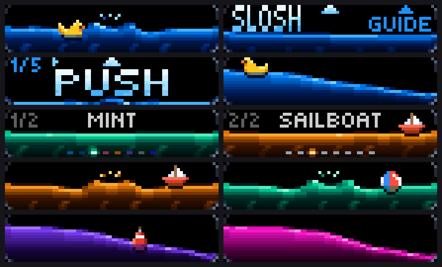

# Slosh

Slosh turns the BUSY Bar into a small glass tank, half full of water, with something floating on it. The water is simulated, not played back: push it or tilt it, and waves travel, climb the glass, come back, cross each other and slowly die down.

*The pictures are the app's own screens, captured from the BUSY Bar Emulator.*

## What you see

- **The tank**: water seen from the side, with a line of light on its surface, darker towards the bottom, faint streaks of light falling through it, and round glass corners. Left alone, the surface swells slowly and a glint travels along it.
- **A push**: the surface dips in the middle, a crown jumps up and throws a few drops, and waves run out to both sides, splash against the glass and return.
- **A tilt**: every click of the knob shoves the water to one side. Turn faster and the wave grows, a front breaks with foam on it, and spray flies where it hits the wall. The amount of water never changes.
- **Something floating**: a rubber duck, a sailing boat, a paper boat, a message in a bottle, a beach ball, an ice cube or a buoy with a blinking light. It rides the waves, leans with them, drifts with the water, is thrown up by a push from below and lands with a small splash of its own. The ball is light and bouncy, the ice sits low, the bottle rolls.
- **Eight waters**: CLEAR, DEEP SEA, MINT, ROSE, WHISKY, INK, MERCURY and RAINBOW, which slowly wanders round the colours.
- When you leave, the water runs out and whatever floated is left lying on the floor for a moment.

## Controls

- **On the tank**: Start pushes the water in the middle. Turn the knob to tilt the tank to that side. OK opens a page of two steps. Back lets the water out and exits.
- **Step 1/2, the water**: turn the knob through the eight waters, each shown at once in the tank, with its name above and eight small lights on the floor. OK or Start takes it and goes on to step 2. Back returns to the tank.
- **Step 2/2, what floats**: turn the knob through none, the duck, the sailing boat, the paper boat, the bottle, the ball, the ice cube and the buoy. Each one drops in beside its name and rides the water while you choose. OK or Start takes it and returns to the tank; press at once to keep what you had. Back goes a step back, to the waters.
- **The guide**: the first time you open the app, five short pages show the controls, one per page, written in the water's light over a shallow water that already moves a little when you touch a key. You turn them yourself: Start, OK or a turn forward for the next page, a turn backward or Back for the one before; after the last page the tank is there. The guide does not come again by itself.

## Settings

- **Floating**: none, or one of the seven things. The duck is there from the start. Changing it changes what floats; so does step 2 on the bar, and the last change counts.
- **Calm**: the water also moves by itself now and then, a gentle push every half minute. On from the start.
- **Start over**: flip this switch, either way, to clear what the app has kept. It begins like new: the guide, fresh water of the first colour, and the thing that Floating names. Each flip starts over once.

## Good to know

- The floating thing steps aside while the waters are chosen, so that the name is not covered.
- The water moves at its true speed however fast the bar draws.
- At every start the author's mark is shown for a second and a half; Back during it, or on the guide's first page, leaves the app.

## Data and privacy

- The app keeps one small file on the bar: the water and the floating thing you chose, and that the guide has been seen.
- It does not use the internet and has no account. Nothing leaves the bar.
- All drawings are the author's own. The names of the waters are names of colours. The app is not affiliated with any maker of toys, drinks or aquariums.
