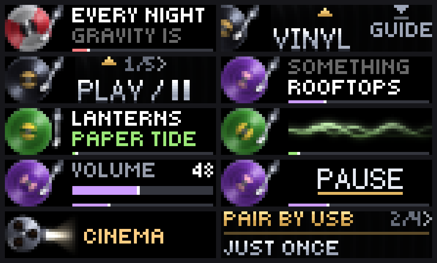

# Vinyl

Vinyl shows what you are listening to as a record player: a record that turns while the music plays, and beside it the lyrics in two rows, karaoke style. Start plays and pauses, the knob is the volume, OK changes the view.

The app has to be told what is playing: by Vinyl for Mac, a small program for your Mac, or by your own Spotify keys. You need only one of the two.

*The pictures are the app's own screens, captured from the BUSY Bar Emulator. The songs in them are made up.*

## What you see

- **The turntable**: every album gets one of twelve records, always the same one. The arm comes down when the music starts and lifts when it pauses.
- **Lyrics**: two rows that take turns: the bright one is being sung, the dim one comes next.
- **Song info**: title, artist and album, one at a time; long names scroll up.
- **Waves**: a ribbon of light in the record's colours (it does not hear the music).
- A thin line shows how far the song is. A video (Mac only) becomes a film projector.

## Controls

- The app opens on its main screen. Start enters, pressing the knob (OK) opens the guide, Back leaves; left alone it enters in 4 s.
- **Start**: play / pause.
- **Turn the knob**: the volume of the Mac, or of the device Spotify plays on.
- **OK**: the next view (lyrics, song info, waves). It stays until you press OK again.
- **Back**: leave the app.
- A label answers every press. The first time, the guide opens by itself.

## Setting up

- **Vinyl for Mac** (macOS only): get [helper/vinyl_helper.py](helper/vinyl_helper.py) from this folder and start it with the Python that comes with macOS (it installs nothing). Connect the bar to the Mac by USB once, with Vinyl open: they pair, and from then on they talk over Wi-Fi. It works with players that report to macOS's Now Playing.
- **Or Spotify, with a phone alone**: make your own app at Spotify once and paste its ID, secret and a one-time code into the settings. Play, pause and volume need Premium.
- Until one is set up, the bar shows the steps in short and its back screen a code to scan. The full steps are in [SETUP.md](SETUP.md).
- If the Mac stops answering, the bar says OFFLINE, then MAC NOT FOUND or NO WI-FI, and BACK ONLINE when it returns.

## Settings

- **Spotify client ID, client secret, code** (or a refresh token): for Spotify without a Mac.
- **Vinyl for Mac address and code**: only if the bar is never plugged into the Mac.
- **Lyrics**: on. **Karaoke colour**: off. **Words timing**: Normal, Earlier or Later (0.15 s). **Volume knob**: either way.
- **Start over**: flip the switch to clear what the app has kept.

## Lyrics

- Synced lyrics come from [lrclib.net](https://lrclib.net), a free public service without accounts. It has them for many songs, not for all; a song without them says NO LYRICS FOUND. The bar needs Wi-Fi for them.
- The bar's small letters are Latin capitals: Chinese, Japanese, Korean and other scripts cannot be shown. For a title in such a script the artist or the album stands in.

## Data and privacy

- For lyrics, the bar sends the song's title, artist, album and length to lrclib.net. No account, no identifier.
- Your Spotify values go from the bar to Spotify only. No keys of the author are in the app.
- Vinyl for Mac talks to your bar only. It runs a small server on your own network that says what is playing, and takes play / pause and volume, only for holders of a six-digit code that the bar gets when you pair.
- It reads macOS's Now Playing through an undocumented system framework; a future macOS may break that. Then it can ask the players directly (`--ask-apps`).
- Kept on the bar: the lyrics of the last 20 songs, what Spotify gave for your code, and a few small state files.
- Not affiliated with or endorsed by Spotify, Apple, lrclib.net or any music or video service; their names only say what the app works with.
